 

 
 

<picture>
  <source media="(prefers-color-scheme: dark)" srcset="https://skillicons.dev/icons?i=ts,react,nextjs,threejs,vite,python,java&theme=dark" />
  
</picture>

Arch + Neovim on a Colemak split.

